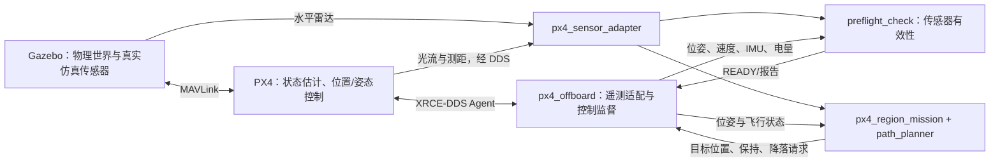

# 模块 C 备赛与现场适配讨论稿

> 根据用户提供的模块 C 题目和当前工程代码整理。本文件用于讨论备赛方案；本轮只增加文档，不修改飞行逻辑。已实现、已验证、建议开发分别说明，不把训练成功等同于正式比赛验收。

## 一、先给结论

当前工程已经有真实 PX4/Gazebo 闭环飞行基础，两条训练路线都有完成、降落和上锁记录。它适合继续备赛，不需要从头重写飞控。

现场适配还需要准备：**可配置的场景与接口、统一 Launch、明确的悬停与轨迹指标、评分日志、简短的排障和归档流程。** 当前版本带有本机路径、训练地图和定制 PX4 消息发布的依赖，不能保证复制到任意比赛电脑即可启动。

备赛要练习的是：拿到场景和接口后，能快速确认坐标、改任务配置、建立通信、完整飞行、用日志证明结果。现场能否带入现成工程，必须由赛方规则确认。

## 二、比赛电脑会提供什么

### 2.1 题目能够确认的内容

| 题目内容 | 能得出的结论 |
|---|---|
| 专用计算机机房，单人单机 | 在赛方计算机完成操作；实际硬件配置未给出 |
| Ubuntu 22.04 LTS、ROS2、PX4/ArduPilot、Gazebo | 规定了平台类型，没有列出具体安装版本或完整软件清单 |
| 竞赛指定机场、沙盘、隔离墙与标识 | 需要适配指定场景，不能假设当前重建训练 world 就是正式资源 |
| 180 分钟、28 分 | 180 分钟是整个模块作业时限；不是一次飞行必须 180 秒 |
| 全程 EV 录屏、代码和视频封存 | 要准备可检查的完整操作记录和提交材料 |

**题目已经明确官方平台，我们继续按现有技术路线备赛。** 默认按平台就绪练习选手任务代码；具体预装版本、场景文件和模板清单用赛务技术说明核对。当前文件逐项用途和来源见《当前目录与比赛代码对应说明》，不把上游平台与选手自主代码混为一谈。

### 2.2 必须向赛方核实的条件

| 待确认事项 | 为什么影响备赛 |
|---|---|
| CPU、内存、显卡、虚拟机类型及 3D 加速 | 决定画面和传感器能否实时运行 |
| ROS2 发行版、Gazebo Classic 或新 Gazebo、PX4/ArduPilot 版本 | 决定插件、接口和消息定义，当前实现针对 Humble + Classic 11 + PX4 v1.14.3 |
| 提供的 world/model、机型、传感器、坐标表、起降点和墙高 | 决定地图解析、通道净距、坐标转换和控制高度 |
| 提供的源码模板、工作空间和飞控接口说明 | 决定现场主要写算法还是还需搭通信 |
| 是否允许带源码、压缩包、笔记、离线依赖；是否要求现场独立编写 | 决定现有工程能直接使用，还是只能用于平时训练 |
| 是否联网、有无 sudo、是否允许安装包或改飞控发布配置 | 当前 DDS 定制和编译步骤可能受限制 |
| 地面站要求、如何判定通信延迟 | 是否需启动指定地面站，以及保存哪些测量证据 |
| 2.5 m 的高度基准、稳态时间窗、降落误差阈值和判定坐标 | 防止相对起飞高度和世界绝对高度混用 |
| 两条路线如何指定，是否都要飞，允许几次正式尝试 | “两次机会”是目前训练安排，并非这段题目已确认的赛规 |
| 是否允许降低传感器/物理频率或简化外观 | 低配模式不能自行替换正式模型或改变考核条件 |
| EV 的安装启动方式、保存格式、命名、提交目录和封存方式 | 防止功能完成却缺少录屏和归档材料 |

建议向赛方索取“软件版本清单、资源包、接口表、允许携带材料及提交规范”。这比猜测现场会提供什么更有用。

## 三、现有文档怎么读

| 文档 | 用途 | 阅读顺序 |
|---|---|---|
| `README.md` | 工程总入口、正常四终端操作和主要话题 | 1 |
| 本文件 | 按评分项讨论差距、备赛内容和现场方案 | 2 |
| `docs/仿真功能与双路线启动说明.md` | 当前训练版本的路线、参数、启动命令与成功记录 | 3 |
| `docs/低配虚拟机运行.md` | 低配场景、启动与性能采集 | 需要虚拟机时 |
| `docs/虚拟机迁移与依赖安装.md` | 新系统安装、复制、重建顺序 | 迁移时 |
| `docs/仓库与依赖管理.md`、`dependency-sources.json` | 源码、依赖版本与 Git 元数据说明 | 打包前 |
| `docs/功能验证流程.md` | 开发故障注入和阶段性验证方案 | 专项测试时 |
| `docs/现场记录/`、`logs/flight/` | 历史排障材料、实际任务和飞行证据 | 验收时 |

`功能验证流程.md` 有早期阶段描述，例如左路线“待验证”和旧的 0.35 m 净距。当前实际参数以 `config/mission.yaml` 为准，成功状态看对应结果日志；备赛整理时应更新旧描述，避免现场读错文档。

## 四、代码结构和运行关系

以下为实际存在的目录，路径相对 `bao`：

```text
bao/
├── README.md
├── docs/                         说明、现场记录和依赖来源
├── scripts/                      启动、构建、检查和训练工具
├── config/px4-rc.params          PX4 测距安装位置、高度参考、电池参数
├── uav_competition_ws/src/uav_competition/
│   ├── package.xml / setup.py    ROS 包依赖、资源安装和可执行入口
│   ├── launch/                   ROS 节点启动组合
│   ├── config/mission.yaml       起降点、区域目标、双路线和规划配置
│   ├── worlds/                   训练场景
│   ├── models/                   带传感器的 Iris 和光流地面纹理
│   ├── uav_competition/          Python 业务代码
│   └── test/                     规划与低配场景检查
├── px4_msgs_overlay_ws/src/      匹配当前飞控的消息定义
├── PX4-Autopilot/                飞控、Gazebo 插件和定制 DDS 发布配置
├── Micro-XRCE-DDS-Agent/         ROS2 与 PX4 的 XRCE 通信代理
├── third_party/ / patches/       依赖和修复
├── tools/vm_gui/                 低配界面限帧插件
└── logs/                        运行结果、飞控 CSV/JSON、仿真日志
```

### 4.1 真正飞行时用哪些文件

| 文件 | 职责 | 现场主要改什么 |
|---|---|---|
| `scripts/run_xrce_agent.sh` | 启动 DDS Agent | 代理位置、传输地址/端口（如赛方不同） |
| `scripts/run_px4_competition.sh` | 构建并启动 Gazebo、GUI、PX4 | world、机型、飞控位置和启动方式 |
| `scripts/run_px4_vm.sh`、`prepare_vm_scene.py` | 生成并启动训练低配场景 | 仅在赛方允许修改对应配置时使用 |
| `launch/px4_regions.launch.py` | 启动 Offboard、传感器转发、自检、区域任务 | 将来暴露 world/config/interface 等参数 |
| `uav_competition/px4_offboard_node.py` | NED/ENU 转换、起飞基准、Offboard 心跳、模式/解锁、位置参考、保护和接地确认 | 接口、坐标、高度基准及控制配置 |
| `uav_competition/px4_sensor_adapter.py` | 光流、向下测距和水平雷达转发 | 官方传感器话题和消息映射 |
| `uav_competition/preflight_check.py` | 校验数值、源时间戳、新鲜度、光流质量、电量和测距 | 官方传感器规格对应的有效性条件 |
| `uav_competition/px4_region_mission.py` | 区域顺序、异步重规划、障碍记忆、走廊保护、降落进近 | 任务阶段、规划/轨迹衔接 |
| `uav_competition/path_planner.py` | 墙体膨胀、二维 A*、碰撞检查和直线可见性简化 | 官方地图解析及路径算法 |
| `config/mission.yaml` | 起降点、区域和路线、巡航高度、速度、部分保护 | 现场最常修改的任务配置 |
| `scripts/check_px4_sensors.py` | 采样传感器和位姿证据 | 改成同时支持不同传感器规格的检查 |

通信链路：



图中的普通遥测和指令话题是 ROS2；Gazebo 真值单独供记录，不输入现有导航控制。地面站的完整界面与延迟验证仍需补齐。

### 4.2 旧的 MOCK 路径不要混用

`simulation.launch.py`、`mission.launch.py` 及 `mock_flight.py`、`sensor_adapter.py`、`mission_controller.py`、`safety_manager.py` 是早期练习路径，不是当前 PX4 实际飞行主链路。

当前真实飞行的围栏和保护主要在 `px4_offboard_node.py`、`px4_region_mission.py`，不能只看 `safety_manager.py` 就判断真实模式的行为。MOCK 的固定电量/代理传感器不能作为评分证据。建议后续归入清晰的练习目录，保留单一正式运行入口。

## 五、对照 28 分要求，目前处于哪一步

| 评分项 | 分值 | 现有基础与证据 | 还需补齐或核实 |
|---|---:|---|---|
| 场景与 Launch | 2 | 统一 Launch 已直接管理场景、PX4、Agent 和业务节点 | 官方机场、泡沫砖和标识一致性；现场资源兼容性 |
| 通信与遥测 | 4 | 已用真实 PX4 话题控制飞行，位姿/速度/电量/传感器贯通 | 官方接口匹配、地面站联调、频率和延迟证据 |
| 起飞前自检 | 2 | IMU、光流、雷达、测距、电量有效性检查 | 现场数据规格和异常条件验收 |
| 超时、围栏与走廊保护 | 2 | 真实控制链路具备保护；已有保护触发记录 | 专项故障证据仍需整理；不能把正常飞通当成保护全通过 |
| 2.5 m 起飞与悬停 | 3 | 自动解锁、垂直起飞；巡航前需连续 1 秒满足高度/位置条件，独立悬停模式可保持 5 秒 | 明确官方高度基准和稳态窗；巡航模式补可配置悬停与误差统计 |
| 区域 2→3→4→5 规划循迹 | 8 | 两条训练路线有 COMPLETE、接地和上锁记录；已加入平滑跟踪 | 官方区域边界/任务坐标适配；实际飞越记录 |
| 动态优化与墙体避障 | 2 | 静态避墙已飞通；雷达未知障碍、保持和重规划已实现 | 临时实体障碍成功绕行、稳定性和耗时证据；不能宣称连续空间全局最优 |
| 靶标定点降落 | 3 | 按配置坐标减速进近、LAND、接地检测、上锁 | 官方误差规则、独立位置证据及落点统计 |
| 职业素养 | 2 | 有分层目录、文档、参数和日志 | 核心代码/控制参数注释、最终目录、EV 全程录屏和封存演练 |

**没有赛方验收，不能据此给自己结算“已经拿到多少分”。** 目前是主要功能已形成，官方适配、定量证据和现场操作尚未全部完成。

本地保存的近期训练记录包括右路线 `region_20261022_112212.json` 和左路线 `region_20261022_112416.json`，均为 COMPLETE；对应飞控结果确认自动上锁。这些证明训练任务成功，不替代官方地图和精度验收。

题目要求“虚拟靶标定点降落”，所贴文字没有明确要求视觉识别。如果赛方直接给靶标坐标，可以采用坐标进近；只有官方要求视觉定位或目标位置未知时，再开发识别与视觉伺服。不要现在无依据扩大工作量。

## 六、当前结构适配现场吗

**业务分层可以复用，环境入口和地图假设需要改。** 优先解决以下具体问题：

1. **正式场景入口已统一。** `competition.launch.py` 管理场景、PX4、Agent、业务节点，并保留连接已有平台的参数。
2. **配置入口已参数化。** `site.yaml`、`mission.yaml`、`interfaces.yaml` 和 Launch 参数支持场景、坐标、路线、接口及模型路径替换。
3. **地图解析有强假设。** 规划器只读取 world 顶层、名为 `wall_*`/`boundary_*` 的轴对齐 box；不支持旋转墙、include 中的碰撞体、嵌套 pose 或一般网格，并把边界写为 0～10 m。官方模型不同就可能漏障碍，不能只换 world 路径。
4. **坐标绑定训练图。** 现有地图为了画面做了 x 镜像，位置由起飞点和本地 NED 原点换算。现场应明确地图→世界→局部 NED 转换及雷达安装变换，不应继续凭画面左右试坐标。
5. **高度定义需核对。** 当前巡航高度是相对启动时基准上升 2.5 m；飞机落地时 base_link 本身高于地面。题目正式采用 AGL、机体中心世界 z 还是相对起飞高度，需要确认，不能一律认定等价。
6. **依赖定制飞控。** 现有自检依赖 DDS 发布原始光流、测距、电量、接地状态和指令回执；赛方标准固件未必发布同一组话题。需要接口检查和获准后的配置方案，不能现场盲改消息定义。
7. **“平滑”已完成训练级实现。** 轨迹有碰撞检查的圆角、转弯减速和参考加速度限制；仍需在现场资源上做实际 PX4 跟踪验证，不能只用静态单元测试代替。
8. **低配优化仍需现场许可与验收。** 简化训练外观、降频不是官方场景适配的替代品；官方机型、传感器和物理配置可能固定。保留标准模式，官方允许什么才改什么。
9. **评估记录不足。** 当前独立 Gazebo 真值主要记录高度；最终平面位置来自 PX4 估计，不应作为独立着陆评分真值。巡航模式也没有完整复用独立悬停模式的误差统计。
10. **有重复配置和零散常量。** YAML 中旧 route/areas 与实际 route_profiles 并存；部分时间阈值、场地范围和传感器安装假设仍在 Python 内。需要标清真正生效配置，统一少量关键入口。
11. **诊断工具还需跟上低配模式。** `check_px4_sensors.py` 当前把雷达有效条件写成恰好 360 束，会误标低配 180 束扫描；应按消息结构和配置判断。运行自检 `preflight_check.py` 不存在同一项 360 束限制。

现阶段不建议为了目录漂亮拆成大量 ROS 包，也不建议重写 PX4 内部 PID。先保留业务包，把配置、适配和评估边界做清楚即可。

## 七、后面具体写哪些代码

以下是后续现场适配和验收项；P0 的统一 Launch、场景参数化、地图坐标框架、轨迹平滑基础和动态障碍日志工具已在本轮实现。

| 优先级 | 建议文件/改动 | 解决的问题 | 验收方式 |
|---|---|---|---|
| P0 | `launch/competition.launch.py` | 统一场景、飞控、Agent、业务的启动；可选择连接已有平台 | 一条 Launch 命令加载场景；只在必要进程启动成功后进入后续阶段 |
| P0 | `config/site.yaml` + Launch 参数 | 明确 world、任务、接口、模型路径及运行模式 | 换目录/用户名后无需改 Python；现场只改适配配置 |
| P0 | `scripts/inspect_environment.py` | 检查版本、资源、消息、端口、发布者和传感器数据 | 一份报告指出缺失项，失败阶段可定位，不自动改系统 |
| P0 | 传感器/飞控接口映射配置 | 将官方话题映射到稳定 `/uav/*` 内部接口 | 同一业务节点可接赛方数据；类型/坐标/单位不匹配时明确报错 |
| P0 | `map_loader.py`、`frames.py`，改规划器 | 解析官方碰撞/坐标，去掉固定名称和范围假设 | 使用官方资源或已知几何样例比较碰撞与坐标；不支持的几何明确拒绝 |
| P1 | `trajectory.py`，改区域任务和控制参考 | 碰撞约束下限速、转弯减速、加速度限制 | 轨迹不切墙，实际位置/速度连续；不只看曲线外观 |
| P1 | 起飞后可配置悬停阶段 | 一次完整任务内展示 2.5 m 定高，而非另飞悬停测试 | 有明确稳态区间，记录高度误差，再进入 AREA_2 |
| P1 | `evaluation.py` / 采样记录器 | 高度误差、区域通过、落点、接地/上锁、消息新鲜度和规划耗时汇总 | 使用真实采样生成结果，缺少独立真值则标记未测，不填造合格结果 |
| P1 | 修订传感器检查脚本 | 兼容 180/360 束等配置，减少现场误诊 | 同一结构校验能识别合法扫描和无效/断流数据 |
| P2 | `scripts/archive_run.sh` | 按一次运行归档代码版本、配置、日志、评分结果和已保存视频 | 每次有独立目录与清单，不覆盖旧记录；EV 停录后检查文件完整 |
| P2 | 精简正式启动文档、旧 MOCK 入口与注释 | 减少现场选错脚本和参数的机会 | 从新终端照短手册完成全程；旧练习不混进正式链路 |

底层姿态/位置环沿用 PX4。我们需要理解并注释：参考位置如何产生、坐标如何变换、速度/爬升参数如何影响控制、选用哪些 PX4 参数及其依据。题目提到 PID 注释，不意味着必须现场重新编写一套飞控 PID。

如果官方只提供 ArduPilot，则当前 `/fmu/*` Offboard 适配不能直接使用，需要另写控制/遥测适配层；规划和区域任务可尽量复用。赛前优先确认平台，不建议无依据同时维护两套飞控。

## 八、怎么调试：按链路定位

| 现象 | 先看哪里 | 先证明什么 |
|---|---|---|
| 地图或飞机不显示 | world/model 路径、`gzserver.log`、`gzclient.log`、图形驱动 | 世界与模型资源可加载，服务端和 GUI 都正常 |
| PX4 停在等待模拟器 | TCP 4560、模型 MAVLink 插件、服务端日志 | 模拟器与飞控建立连接；不要先改规划参数 |
| ROS 无 `/fmu/out/*` 数据 | Agent、DDS 客户端、ROS_DOMAIN_ID、消息版本 | 有真实新数据；topic list 只证明发现话题 |
| 自检不 READY | `/uav/preflight/report` 与对应原始话题 | 哪个传感器无效、断流、重复时间戳或质量不足 |
| start 成功但没起飞 | 任务/飞行状态、模式和解锁回执 | 服务已受理后是否实际进入 SET_MODE、ARM、TAKEOFF |
| 起飞后立即降落 | 第一条 Protection/failure、原始传感器和状态 | 是真实危险、数据陈旧、超时还是规划无解；不先放宽全部阈值 |
| 过不了通道 | 静态碰撞、机体包络、估计位置、雷达未知点、路径 | 是通道物理不足还是坐标/地图/障碍记忆错误 |
| 飞行正常但 GUI 卡死 | 实时因子、CPU/内存、GUI 日志 | 是渲染问题还是整个物理仿真变慢 |
| COMPLETE 但落点不准 | 最终进近、接地时刻、官方评分坐标 | 完成状态、落点精度是两个判定，不能互相替代 |

常用读取命令，按当前训练接口示例；官方接口不同就换成官方名称：

```bash
set +u
source /opt/ros/humble/setup.bash
source "$HOME/桌面/bao/px4_msgs_overlay_ws/install/setup.bash"
ros2 topic info /fmu/out/vehicle_status -v
ros2 topic echo /fmu/out/vehicle_status --once --qos-reliability best_effort
ros2 topic echo /uav/preflight/report --once
ros2 topic echo /uav/flight/state --once
ros2 topic echo /uav/mission/state --once
```

频率和消息间隔可以通过采样测量；端到端延迟只有在源时间戳、时钟域和同步方式明确后才能计算。不能简单用 wall time 减 PX4 启动时间戳，就宣称测到了低延迟。

备赛时提前把断流、走廊偏离、越界、超时和实体障碍绕行分项验证并留证。保护触发通常会结束任务，应在开发训练完成这些试验；**正式比赛按赛方要求飞正常任务，不默认安排每个故障重飞一趟。** 正常任务中保护持续启用，也不能由此推断所有故障分支已测试通过。

## 九、我们怎么备赛

### 当前执行顺序：先主链路，再动态障碍

当前已补统一 Launch、可配置场景/坐标/接口、轨迹平滑和动态重规划工具。接下来先用统一入口跑通右、左两条完整路线，再验证实体临时障碍后的持续飞行；保护逻辑始终在主任务中启用。完整命令、节点输入输出和验收证据见[统一启动与场景轨迹验证](统一启动与场景轨迹验证.md)。

比赛操作链路：**Launch 启动场景/飞控/Agent/节点 → 自检 READY → 请求 `/uav/mission/start` → 自动起飞 → 区域 2→3→4→5 → 靶标进近 → 降落与上锁 → 保存结果**。开始服务由操作者调用一次，后续节点通过 ROS2 消息和服务自动衔接，无需手工逐个调用算法函数。

比赛判定按题目和赛方评分细则执行；本机 COMPLETE 证明任务状态完成，仍需实际区域轨迹、2.5 m 悬停误差、落点坐标偏差及 EV 录屏支撑对应评分项。临时障碍与故障注入用于开发验证，不默认增加正式尝试次数。

### 阶段 A：先消除环境不确定性

取得版本/资源/允许带入材料的说明，在小虚拟机验证冷启动、传感器 READY 和双路线。记录最低实测资源，不用静态规划测试代替飞行性能结果。

### 阶段 B：形成现场适配版本

先做 P0：统一 Launch、路径/接口参数、环境检查、地图与坐标适配。练习将训练地图换成另一张已知地图，或换用户名/目录，检查是否真的只需修改配置。

如果允许带代码，准备带版本和依赖清单的工程；如果禁止带代码，现有工程用于理解与练习，按允许材料范围准备知识清单，并计时练习从赛方模板独立实现核心逻辑。

### 阶段 C：补齐评分证据

再做 P1：悬停阶段、平滑轨迹、动态避障、真实测量报告。高度稳态误差 ≤0.1 m 是正式指标，虽可按既定顺序放在功能之后优化，但不能最后忽略。降落误差阈值未在所贴文字列全，需要官方评分办法。

### 阶段 D：180 分钟计时演练

建议先按下面的时间预算练习，并根据实际水平调整：

| 比赛时间 | 操作与交付 |
|---|---|
| 0～10 分钟 | 启动 EV 并确认录制，阅读任务/提交规则，检查资源和软件版本 |
| 10～30 分钟 | 建立工作空间、加载官方场景、确认通信及坐标，不反复下载大依赖 |
| 30～65 分钟 | 完成/适配任务配置、通信、自检和起飞控制，确保能解锁起飞 |
| 65～105 分钟 | 完成区域规划、循迹与避障，检查区域顺序和规划结果 |
| 105～135 分钟 | 完整任务、靶标进近、接地上锁与指标记录；飞行次数服从赛规 |
| 135～160 分钟 | 处理具体失败、核对代码注释和配置，尽量避免大改架构 |
| 160～180 分钟 | 最终结果检查，按要求保存代码/参数/日志/视频，停录和封存交接 |

时间表假定基础平台可用；如果赛方要求从空系统安装，必须按赛务说明重新分配。180 分钟内现场下载和重建整个 PX4/Fast DDS 并不稳妥，赛前应确认离线依赖或预装条件。

## 十、建议整理的比赛提交目录

这是建议结构，赛方若给目录模板则以赛方为准：

```text
submission/考号_模块C/
├── README.md                 环境版本、启动命令和结果说明
├── src/                      要求提交的自主控制与规划源码
├── launch/                   启动脚本
├── config/                   实际使用的任务、接口及控制参数
├── scene/                    要求归档且允许提交的场景和资源
├── results/本次运行编号/       原始日志、任务结果、指标统计和飞控日志
├── video/                    EV 保存的完整视频
└── manifest.txt              文件清单、版本和必要的完整性校验
```

开发目录中的完整 PX4、Agent 和缓存用于复现；比赛交哪些依赖按赛规确定，不默认把数 GB 构建缓存混入提交。成功/失败和测量结果如实保留；视频和系统日志应能对应同一次实际运行。

## 十一、本轮讨论建议

建议下一步顺序是：**确认官方环境与材料规则 → 做现场适配入口 P0 → 在低配环境完整飞行 → 补悬停、轨迹和结果评估 P1 → 录屏归档与计时演练。**

暂时不继续逐个试改通道坐标，也不先做视觉识别或重写底层飞控。当前最值得先确定的是赛方提供的版本/场景与可带入材料规则；拿到后就能判断哪些代码现场复用、哪些必须现场完成。
