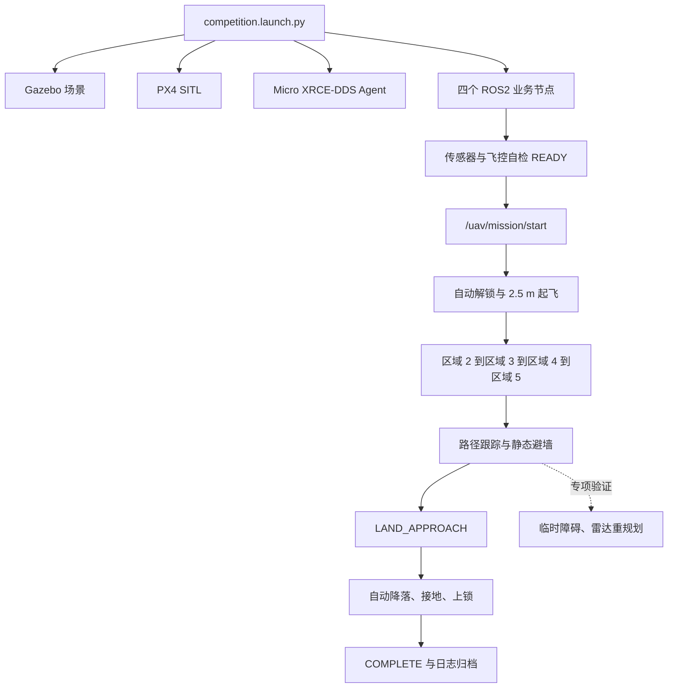

# 统一启动、场景适配与轨迹验证

## 1. 本轮完成与验收范围

| 项目 | 当前实现 | 还需现场运行验证 |
|---|---|---|
| 顶层 Launch | 直接管理 Gazebo 服务端/界面、PX4、Agent、四个业务节点；支持复用已有平台 | 本机 GUI、真实传感器和完整任务的联合启动 |
| 场景适配 | world、任务 YAML、接口 YAML、平台路径、地图边界及坐标变换可配置 | 正式资源的几何、坐标、消息类型与单位核对 |
| 平滑与避障 | 碰撞约束下的二次曲线圆角、弯道减速、水平参考加速度限制、真实实体障碍和证据汇总 | PX4 实际转弯跟踪及临时障碍后的完整绕行 |

离线检查覆盖双路线、旋转/嵌套静态模型、坐标变换、路径平滑、参考跟踪、未知障碍规划和日志关联。**没有由工具自动启动仿真、解锁或试飞；实飞结果等用户运行后验收。**

## 2. 比赛时的主流程

比赛操作按“先启动系统，再显式开始任务”的顺序进行。第一轮先验证完整主链路，不注入临时障碍；动态避障功能仍随主程序加载，但在单独验证阶段再人为加入障碍。



Launch 只负责进程、环境和参数，不直接调用 Python 类函数，也不会自动解锁。节点启动后通过 ROS2 话题、服务和定时器协作：`preflight_check` 发布自检报告，`px4_offboard` 管理 PX4 模式/解锁/位置参考，`px4_region_mission` 管理区域顺序和规划。`start_mission_when_ready.sh` 等待两个 READY 后调用 `/uav/mission/start`；区域任务收到请求后再调用 `/uav/flight/start`。

| 节点 | 主要输入 | 输出或动作 |
|---|---|---|
| `px4_sensor_adapter` | PX4 光流、向下测距及 Gazebo 水平雷达 | 统一传感器话题，供自检和任务使用 |
| `preflight_check` | 位姿、速度、IMU、电量、光流、测距、雷达 | 发布 `/uav/preflight/ready` 和 `/uav/preflight/report` |
| `px4_offboard` | PX4 遥测、自检结果、任务位置/速度/保持请求 | Offboard 心跳、模式与解锁命令、位置参考、降落命令、飞行状态 |
| `px4_region_mission` | 任务开始服务、位姿、飞行状态、雷达 | 调用起飞服务，计算航迹，发布位置/速度/保持目标，管理区域与降落 |

`path_planner.py`、`trajectory.py` 是任务节点导入的 Python 算法模块，无需另开终端逐个执行。PX4 接收 ROS2 控制消息后完成位置/姿态闭环和电机输出；选手程序不直接控制四个电机。

第一轮完整流程建议只看这些结果：

```text
COMPETITION_READY
→ mission STARTING
→ flight TAKEOFF
→ flight ACTIVE
→ AREA_2 → AREA_3 → AREA_4 → AREA_5 → LAND_APPROACH
→ 自动降落、Disarmed
→ mission COMPLETE
```

服务返回 `success=True` 只代表任务请求被接受，不能单独作为比赛完成证明。完成依据是最终任务 JSON、PX4 飞行结果 JSON/CSV、接地/上锁状态和录屏中的完整过程。

节点之间不要求比赛人员手工调用内部函数。常用 ROS2 接口如下：

| 目的 | 接口 |
|---|---|
| 等待后开始正式任务 | `./scripts/start_mission_when_ready.sh` |
| 直接请求区域任务 | `/uav/mission/start`，`std_srvs/srv/Trigger` |
| 请求飞行开始 | `/uav/flight/start`，`std_srvs/srv/Trigger`；完整巡航由任务节点调用，单独悬停需使用悬停 Launch |
| 紧急降落 | `/uav/flight/land`，`std_srvs/srv/Trigger` |
| 查看自检 | `/uav/preflight/report` |
| 查看飞行状态 | `/uav/flight/state` |
| 查看任务阶段 | `/uav/mission/state` |

### 开发与验证顺序

1. **先完整飞通。** 场景、通信、自检、安全保护一起接入，先完成右路线的起飞→巡航→降落；随后验证左路线。每趟自动完成整个任务，操作者无需到一个区域就调用一次函数。
2. **再验证动态障碍。** 保留已有避障代码，在完整主流程稳定后，于合适航段加入临时实体，确认雷达发现→保持→重新规划→继续飞行→降落。当前已具备实现和工具，下一步是实际仿真验收。
3. **开发期验证保护分支。** 断流、走廊偏离、越界、超时通常会终止任务，按需在训练中验证并留证。正式比赛正常任务中保护持续运行，不默认安排逐项故障注入或多次重飞。
4. **补定量指标与归档。** 功能稳定后统计悬停误差、轨迹连续性、落点偏差，核对代码注释、日志和 EV 视频。2.5 m 高度稳态误差 ≤0.1 m 仍是题目指标，不能用 COMPLETE 代替。

以上是开发验证顺序；正式任务中的避墙、规划和安全监控随任务自动运行。左右各飞一次是目前备赛安排，正式尝试次数和路线选择按赛规执行。

### 比赛如何判断

下面按所提供题目整理验收证据，具体自动评分器、判定话题、采样方法和阈值由赛方评分说明确定。我们自己的状态和 JSON 是排障、留证材料，不能替代裁判判定。

| 题目要求 | 应展示的结果与证据 |
|---|---|
| 场景与通信 | Launch 正确加载指定场景，位姿、速度、电量、传感器和控制消息真实收发；topic list 本身不能证明数据有效或低延迟 |
| 自检与安全 | 起飞前校验 IMU、光流、雷达等；代码和开发验证记录可解释超时、围栏、走廊偏离时的保护动作 |
| 起飞与悬停 | 自动解锁、垂直起飞至 2.5 m，并以稳态窗口采样检验高度误差 ≤0.1 m |
| 多区域巡航 | 实际轨迹依次进入区域 2→3→4→5；目前目标点访问记录需与正式区域边界核对 |
| 规划与避障 | 实际航迹避墙、稳定穿越通道；临时障碍训练保留实体生成、雷达观测、重规划路径及后续飞行记录 |
| 靶标降落 | 飞赴回收区、减速对准、平稳接地并上锁；用官方规定的日志坐标计算偏差，COMPLETE 不等于精度满分 |
| 职业素养 | 源码结构与注释、正确归档的工程/配置/日志、全程 EV 录屏及封存材料 |

题目要求动态航线优化与隔离墙避障；目前所贴文字未明确规定正式比赛必须人工添加临时障碍。临时实体注入是我们的验证工具，正式比赛按赛方任务操作。比赛关注实际表现、代码和证据，不以是否调用某个内部 Python 函数作为完成依据。

## 3. 本机启动：两终端

先确认上一趟已落地上锁，再 Ctrl+C 结束旧巡航、Gazebo/PX4 和 Agent 终端。旧四终端流程和新统一流程不能同时启动两套控制节点。

### 终端 1：统一启动

```bash
cd /home/jiaxintang/桌面/bao
./scripts/run_competition.sh route:=right profile:=vm
```

- `profile:=vm`：适配低配虚拟机的训练场景，GUI 15 FPS；首次会编译小型 GUI 插件。
- `profile:=standard`：使用传入的原始 world。
- 左路线只需把 `route:=right` 改成 `route:=left`。另一趟重新启动统一入口。
- 如果 Agent 已在另一终端运行且打算保留，增加 `start_agent:=false`。
- 默认使用已有 PX4 二进制，不每次重编译；缺失或修改 PX4 后增加 `build:=true build_jobs:=1`。
- `headless:=true` 只运行服务端，不显示 GUI。

启动阶段：准备资源 → Gazebo 加载包含无人机的世界 → 检查 MAVLink TCP 4560 监听 → PX4 连接 → 业务节点收到遥测 → `COMPETITION_READY`。

检查 MAVLink 只读取监听状态，不建立探测连接，避免抢占 PX4 的仿真连接。就绪超时会输出失败原因，保留进程用于看日志，不会自行请求起飞。端口被占用会明确报错，不清杀其他仿真。

### 终端 2：请求开始

```bash
cd /home/jiaxintang/桌面/bao
./scripts/start_mission_when_ready.sh
```

该脚本同时等待飞行状态和传感器报告 READY，再请求任务；服务返回成功代表已受理，**以最终任务 COMPLETE、接地及上锁日志判定完成**。

流程：自检 → 2.5 m 起飞与稳定 → 区域 2→3→4→5 → LAND_APPROACH → 降落与上锁。

紧急降落命令（默认接口）：

```bash
source /opt/ros/humble/setup.bash
ros2 service call /uav/flight/land std_srvs/srv/Trigger '{}'
```

落地上锁后再 Ctrl+C 关闭统一启动终端。飞行中关闭节点会触发飞控自身的失联保护。

### 编译自编 ROS2 包

本轮已编译；后续修改业务源码或 Launch/YAML 后，可执行：

```bash
cd /home/jiaxintang/桌面/bao
./scripts/build_and_source.sh
```

## 4. 正式场景如何配置

主包：`uav_competition_ws/src/uav_competition/`。

| 文件 | 配置内容 |
|---|---|
| `config/site.yaml` | 平台路径、模型资源目录、Gazebo master/IP、Agent 端口、PX4 模型名 |
| `config/mission.yaml` | 起飞/降落位置、区域目标、两条路线、速度、高度、边界、净距及保护 |
| `config/interfaces.yaml` | 标准话题/服务名称到现场名称的 ROS2 remap |
| `launch/competition.launch.py` | 进程启动、环境和阶段管理 |
| `launch/px4_regions.launch.py` | 四个业务节点及共同参数/接口映射 |

示例：先按现场文件创建对应 YAML，再传入：

```bash
cd /home/jiaxintang/桌面/bao
./scripts/run_competition.sh \
  profile:=standard \
  world_file:=/absolute/site/course.world \
  config_file:=/absolute/site/task.yaml \
  interface_file:=/absolute/site/interfaces.yaml \
  route:=right
```

也可传 `site_file:=/absolute/site/site.yaml`；单独的 Launch 参数优先于 site.yaml。site 中的 `@project`、`@package` 分别展开为工程根目录和 ROS 包资源目录。相对资源路径以 site.yaml 所在目录为基准；任务 `map.model_paths` 以任务 YAML 所在目录为基准。

**场景约定：**

- world 要包含可连接所选 PX4 的飞机及传感器插件。启动器不会再偷偷往场景重复生成 Iris，也不会移动官方模型。
- `mission.takeoff` 必须对应飞机落地后的地图位置，`landing_target` 和各区域目标使用同一地图坐标。
- 规划边界是 `map.bounds: [xmin,xmax,ymin,ymax]`；围栏单独配置 `safety.bounds`，两者要一致地覆盖任务范围。
- `route_profiles` 的键即路线名称；可新增配置键，无需改 Python。区域目标有序配置，巡航按 YAML 顺序执行，保留 AREA_2→AREA_3→AREA_4→AREA_5。
- `profile:=vm` 的自动轻量化只支持本工程训练场景；正式 world 使用 `profile:=standard`，避免替换其几何或飞机。
- 当前导航仍是二维规划，固定巡航高度；不是任意三维环境的通用导航器。

### 坐标与传感器安装

任务 YAML：

```yaml
frames:
  map_origin_world: [0.0, 0.0, 0.0]
  map_yaw_world: 0.0
  px4_enu_yaw_world: 0.0
  lidar_pose_body: [0.0, 0.0, 0.0]
```

角度均为弧度。地图到 Gazebo：`world_xy = origin_xy + R(map_yaw_world) * map_xy`。PX4 原生 NED 在适配器转为 ENU，再按配置旋转到地图，水平平移在起飞点标定。雷达安装值为机体系 `[x,y,yaw]`；用于扫描端点投影。

高度指令仍以起飞基准为零；静态障碍切片高度为 `map_origin_world.z + cruise_altitude`。将地图 z 原点设为起飞参考面高度，适用于当前平面场地；多层/坡面场景需扩展高度模型，不能只改 XY。

几何读取不依赖 `wall_*` 命名：支持静态 box、竖直 cylinder、sphere、平面地面、局部 model/include 及平面旋转。圆柱/球使用保守多边形。未解析模型、静态 mesh、倾斜实体和 `relative_to` 会明确报错；此时需要导出已解析的平面碰撞模型或补相应解析器，不会将墙体当成空地。

### 接口改名与已有平台

```yaml
remappings:
  /uav/lidar/scan: /official/lidar/scan
```

映射应用到四个业务节点和就绪检测；消息类型、轴向和单位必须兼容。它只改 ROS 名称，不会自动翻译另一种消息或推断 TF。PX4 DDS 命名空间变化时，需要列出节点实际使用的 `/fmu/in/*`、`/fmu/out/*`。若现场更换消息格式，再修改适配器。

连接已启动的 Gazebo/PX4/Agent：

```bash
./scripts/run_competition.sh start_sim:=false start_agent:=false route:=right
```

业务节点从所传 world 读取碰撞地图，须与正在运行的仿真完全对应。

如果连任务服务/内部状态接口也改名，开始脚本应使用相同配置：

```bash
./scripts/start_mission_when_ready.sh --interfaces /absolute/site/interfaces.yaml
```

## 5. 平滑处理的具体范围

1. A* 求解并做可见性简化。
2. 对折点生成二次 Bezier 圆角，逐段复查静态墙和已观测动态障碍。
3. 圆角不满足净距时缩小半径，仍不可行则保留原折点。
4. 跟踪沿弧长取前视目标，检查实际位置到目标的直线段；根据后续转弯减速。
5. 控制适配器限制水平参考速度矢量变化，再检查每一步参考是否碰撞静态规划地图。
6. 检查前方路径上的雷达新障碍，保持、异步重规划、复查新扫描后继续。

参数在 `trajectory`：`enabled`、`corner_radius`、`sample_spacing`、`lookahead`、`max_xy_acceleration`、`corner_speed`。两条路线的速度、净距和原有保护阈值保持当前配置。

加速度限制作用于位置参考，不等于已经证明飞机实际加速度或加加速度达标；曲线退化回折线时仍需减速。跨区域目标仍保留短暂稳定判定，保护重规划时仍保持；本轮没有取消必要的安全动作。实飞连续性要根据轨迹 CSV 和录屏判断。

## 6. 动态避障专项验证

优先在右路线长航段验证，临时障碍需有足够绕行空间。不要在左侧最窄通道随意堵死通道。

终端 1 启动：

```bash
cd /home/jiaxintang/桌面/bao
./scripts/run_competition.sh route:=right profile:=vm enable_tests:=true
```

终端 2 开始：

```bash
cd /home/jiaxintang/桌面/bao
./scripts/start_mission_when_ready.sh
```

**进入 AREA_4 且出现 PLAN_READY 后**，终端 2 执行：

```bash
./scripts/run_training_test.sh obstacle
```

工具沿当前路径前方约 1.8 m 生成真实 `0.4×0.4×3 m` 静态碰撞实体；不会把障碍坐标直接通知规划器。路线剩余距离不足、飞机尚未 ACTIVE 或路径转回过近时会拒绝添加，不算测试通过。自定义场景可在工具后传 `--config /absolute/site/task.yaml --interfaces /absolute/site/interfaces.yaml`。

预期：生成实体成功 → `PLAN_REQUEST lidar_path_blocked` 且 `obstacle_points>0` → 保持并 `PLAN_READY` → 继续经过各区域 → COMPLETE。

运行完成后，终端会打印本次任务 `region_*.json` 路径。将下面文件名替换为**这次**的结果：

```bash
python3 /home/jiaxintang/桌面/bao/scripts/check_dynamic_avoidance.py \
  /home/jiaxintang/桌面/bao/logs/competition/flight/region_本次时间.json \
  --output /home/jiaxintang/桌面/bao/logs/competition/dynamic_evidence.json
```

工具关联同一趟时间、同一任务区、实际生成成功、生成后雷达触发重规划、得到新路径、全部区域访问以及最终 COMPLETE。缺项输出 INCOMPLETE，旧注入记录或普通区域规划不能算通过。`EVIDENCE_COMPLETE` 是日志链完整，不是物理净距、全局最优或比赛评分认证。

添加记录保存在 `logs/obstacle_injection.json`，每次添加覆盖；下一趟开始前归档本次结果。删除障碍另写 `_removed.json`，保留添加证据。仿真重启后障碍自行消失。

## 7. 日志与现场排障

| 位置 | 内容 |
|---|---|
| Launch 启动时打印的 `~/.ros/log/本次目录/` | Launch 控制台、Gazebo/GUI/PX4/Agent 进程输出；本统一入口不更新旧 `logs/simulation/` |
| `logs/competition/flight/region_*.json` | 目标访问、重规划原因、障碍点、原折线/平滑路径、规划耗时及任务结果 |
| `logs/competition/flight/px4_hover_*.csv/.json` | 实际遥测轨迹、飞控状态、落地/上锁结果；文件沿用历史名称，巡航也在此 |
| `PX4-Autopilot/build/px4_sitl_default/rootfs/log/` | PX4 原始 ULog |
| `logs/obstacle_injection.json` | 最近一次真实实体添加的时间和位置 |

`log_dir:=/absolute/run_logs` 可改业务日志根目录。出现问题先发送统一启动终端从异常前到降落的输出，以及本次 region JSON / Offboard JSON，不先改安全阈值。

旧的 `run_xrce_agent.sh`、`run_px4_competition.sh`、`run_px4_regions.sh` 可继续按历史手册独立使用；本轮新增入口作为后续正式整理方向。
